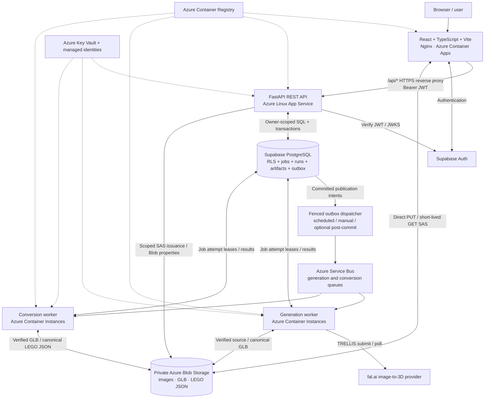
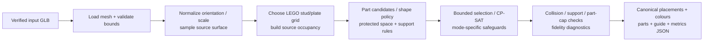
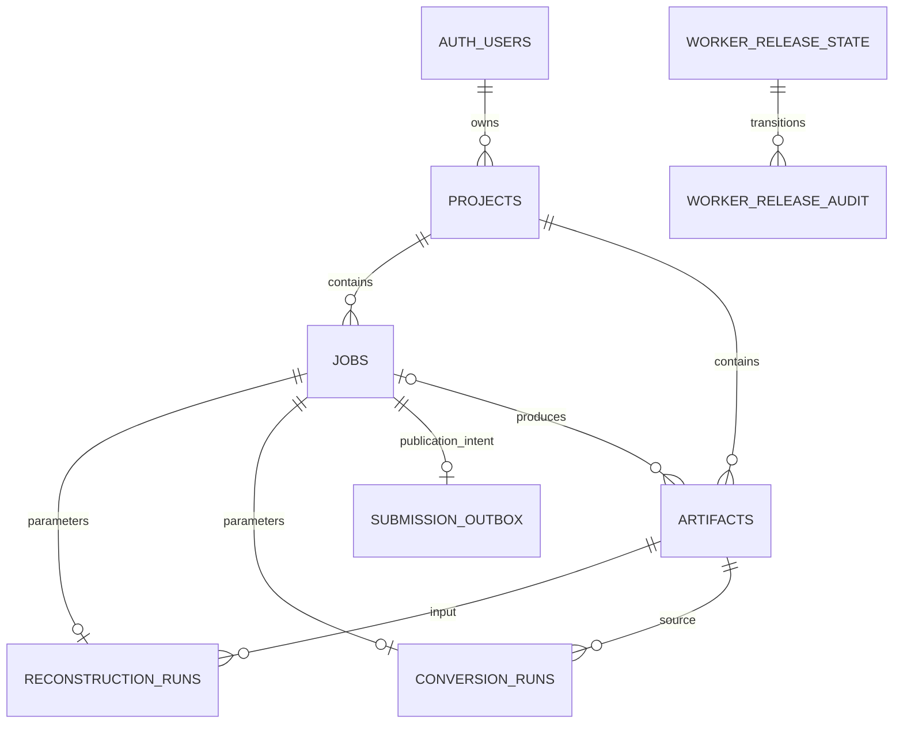

# Image to LEGO

**CS464 Capstone Project: Image-to-3D reconstruction and geometry-aware LEGO conversion**

**Ing Reiwen & Regan Tan**

**Under the guidance and mentorship of Professor Lim Yi Sheng**

[**Open the deployed development application**](https://ca-frontend-image-to-lego-dev.livelywave-453957bf.malaysiawest.azurecontainerapps.io/) · [Demo Video](https://www.youtube.com/watch?v=k3dd4IueMNk) · [Architecture](#system-architecture) · [Run locally](#local-development) · [Conversion algorithms](#how-3d-to-lego-conversion-works) · [Evaluation](#evaluation-and-experiments) · [Testing](#testing-and-reproducibility)

## 1. Project overview

Image to LEGO turns a photograph into a **viewable 3D reconstruction** and then into a **discrete, LEGO-part-based model**. Users can manage private projects, upload an image, initiate AI reconstruction, choose a conversion mode and build complexity, explore the resulting LEGO assembly, inspect its parts list, follow an ordered build guide, and download generated artifacts. The frontend is a React web application; the backend coordinates authenticated REST requests, a managed database, private object storage, asynchronous workers, and a third-party image-to-3D model.

The main technical challenge is **not merely converting mesh vertices into cubes**. A useful result must reconcile image-reconstruction uncertainty, coarse LEGO dimensions, a finite catalogue of manufactured parts and colours, geometric fidelity, processing limits, and some mechanically verifiable assembly constraints. The converter and the offline research harness address these problems explicitly rather than treating a visually similar render as proof of physical buildability.

**Primary users:** LEGO enthusiasts, hobbyists, students, and makers who want to explore a personalized model from an image. 

**Project scope:** an experimental, deployed capstone application—not an official LEGO design tool, a guaranteed physically stable construction system, or a retail purchasing service.

### What is implemented

| Area | Implementation in this repository |
| --- | --- |
| Accounts and projects | Supabase Auth (email/password, Google and GitHub), verified FastAPI sessions, private project CRUD, project status and history |
| Image ingestion | Browser-to-Azure Blob direct upload using scoped, short-lived SAS; server-side metadata confirmation; downstream byte/hash validation |
| 3D generation | Queued, idempotent `fal-ai/trellis` reconstruction; generation worker polls the provider and stores a canonical private GLB |
| LEGO conversion | Deterministic GLB conversion with V3–V7 API routing; V4, V6 and opt-in V7 selectable in the browser |
| Results | Interactive reconstructed-model and LEGO viewers, parts list, verified-pair sourcing CSV, versioned build instructions, GLB/JSON downloads |
| Platform | FastAPI, PostgreSQL, Azure Blob, Service Bus, ACI workers, App Service API, Container Apps frontend, managed identities and Key Vault |
| Reliability | Transactional submission outbox, idempotency, worker-attempt leases, publication fencing, release-drain controls and retry/recovery paths |
| Engineering evidence | Backend/frontend unit tests, isolated PostgreSQL release tests, synthetic benchmarks, documented controlled offline investigations, CI and Terraform |

**Implementation versus deployment:** the code and committed migrations establish the implemented feature set. The Azure inventory supplied for this capstone establishes the named development resources, not an independent end-to-end uptime or load-test result. Likewise, a GitHub Actions workflow being present does not mean its deployment gate is currently enabled.

## 2. User journey

1. **Sign in.** Authenticate using Supabase Auth. The browser sends a bearer access token to FastAPI, which verifies it independently.
2. **Create a project and add a photo.** Pick a JPEG, PNG or WebP image. The API creates a pending artifact and returns a create-only SAS URL; the browser uploads the bytes directly to the private Azure Blob container and then completes the upload.
3. **Generate a 3D model.** A deliberate click submits a reconstruction job. The API commits the job and an outbox publication intent; a dispatcher delivers an identifier-only message to the generation queue. The generation worker verifies source bytes, calls TRELLIS via fal.ai, polls for completion and saves a GLB. The UI polls the owner-scoped job endpoint.
4. **Convert the GLB to LEGO.** Select the build detail and algorithm. The conversion worker verifies the source GLB, runs the chosen deterministic converter and persists one canonical LEGO-model JSON artifact.
5. **Inspect and export.** Compare the original image, reconstructed model and LEGO result; examine grouped part quantities, the build guide and available downloads. The purchase-ready CSV identifies *verified manufactured* part/colour pairs; it does **not** check seller stock or prices.

Generation uses a paid external provider and requires valid credentials, provider capacity and running workers. Queued or failed work must not be described as an instant or guaranteed generation result.

## 3. System architecture



**Figure 1.** Logical data and control flow. The browser uses the frontend's Nginx `/api/` proxy in the deployed topology; Blob transfer is direct. Queue delivery and database state are different reliability boundaries. ACI worker containers have no public ingress.

### Technologies, responsibilities and rationale

| Layer | Technology | Why it is used | Key source |
| --- | --- | --- | --- |
| Web client | React 19, TypeScript, Vite, React Router, TanStack Query | Componentized UI, typed API-facing models and cached job/project data | [`frontend/src/`](frontend/src/) |
| 3D visualization | Three.js, React Three Fiber, Drei | Browser rendering of GLB and individual LEGO placements | [`frontend/src/components/`](frontend/src/components/) |
| Authentication | Supabase Auth; backend PyJWT/JWKS verification | Managed sign-in with independent server-side token validation | [`backend/app/core/auth.py`](backend/app/core/auth.py) |
| Application API | Python 3.12, FastAPI, Pydantic | Explicit REST contracts, validation and dependency boundaries | [`backend/app/api/`](backend/app/api/) |
| Database | Supabase-hosted PostgreSQL, SQLAlchemy async, asyncpg | Relational integrity, indexed project/job lookups, transactions and RLS | [`supabase/migrations/`](supabase/migrations/) |
| Object storage | Azure Blob Storage | Private storage of binary images, GLB and result JSON rather than database BLOBs | [`backend/app/providers/blob_storage.py`](backend/app/providers/blob_storage.py) |
| Async delivery | PostgreSQL outbox + Azure Service Bus | Durable job-intent commit and decoupled generation/conversion work | [`backend/app/outbox/`](backend/app/outbox/) |
| Conversion engine | trimesh, OR-Tools CP-SAT, verified part catalogue | Source-mesh analysis, deterministic bounded part fitting and diagnostics | [`backend/app/conversion/`](backend/app/conversion/) |
| Cloud and release | Azure Container Apps, App Service, ACI, ACR, Key Vault, Terraform, GitHub Actions | Separated web/API/workers, managed resource access and controlled updates | [`infra/terraform/`](infra/terraform/), [`.github/workflows/`](.github/workflows/) |

### Code organization

The backend is a **modular monolith with separate worker entry points**, not independent HTTP microservices. Its dependency direction is:

```text
HTTP route -> application service -> repository / provider contract -> infrastructure adapter
                          |
                          +-> pure 3D-to-LEGO conversion domain
```

Routes handle request/response contracts; services enforce workflows and ownership; PostgreSQL repositories and external-provider adapters own I/O. CPU-intensive conversion and long-running generation are isolated from the API process. The frontend keeps the user journey and 3D rendering separate from those backend implementations.

```text
.
├── backend/
│   ├── app/api/           # FastAPI endpoints, auth dependencies, health
│   ├── app/services/      # Projects, upload, reconstruction, conversion
│   ├── app/repositories/  # Protocols and SQLAlchemy adapters
│   ├── app/providers/     # Blob, Service Bus, fal.ai abstraction/adapter
│   ├── app/conversion/    # Conversion algorithms, catalogue, metrics, experiments
│   ├── app/outbox/        # Durable publication and dispatcher
│   ├── app/workers/       # Generation, conversion, bootstrap, blob sweep
│   ├── scripts/           # Benchmark and milestone runners
│   └── tests/             # Python tests
├── frontend/src/          # React pages, viewers, models, tests and auth
├── supabase/migrations/   # PostgreSQL schema, RLS, leasing and release functions
├── infra/terraform/       # Shared persistent resources and application compute
├── lego_catalogue/       # Curated part metadata and verified colour combinations
├── part_geometry/         # Licensed/source-attributed geometry assets
├── docs/                  # ADRs, architecture, deployment and experimental reports
├── scripts/               # Release safety and catalogue-generation utilities
└── .github/workflows/     # CI and controlled deployment/dispatch workflows
```

## 4. How 3D-to-LEGO conversion works

The reconstruction service creates a **GLB mesh**, not a brick model. The conversion stage independently interprets its geometry and visual colours. The entry point is [`convert_glb()`](backend/app/conversion/core.py), called by the [conversion worker](backend/app/workers/conversion_worker.py).



**Figure 2.** Shared conceptual conversion pipeline. Exact fitting, repair and fallback behavior differ by algorithm; this is not one universal solver used identically by all versions.

1. **Validate and interpret the source.** Read GLB via `trimesh`; reject unsupported, oversized or overly complex input; apply the supplied `upAxis`, normalize the mesh and extract geometry/available visual colour evidence.
2. **Discretize geometry.** Convert continuous coordinates into an integer LEGO lattice (8 mm/stud in the horizontal axes; 3.2 mm/plate vertically). Build a sampled *surface* representation; this is not an exact volumetric reconstruction of the source.
3. **Fit available part families.** Choose legal rectangular brick/plate placements and supported slope placements, using catalogue identities and verified colour combinations. For bounded modes, distinguish preferred detail (`targetParts`) from the **hard maximum** (`maxParts`).
4. **Optimize and safeguard.** Candidate selection uses bounded optimization and/or deterministic local refinement, subject to the algorithm's coverage, protected-space, direct-support and collision policies. Some modes can preserve an earlier valid solution instead of accepting a worse experimental result.
5. **Evaluate the finished assembly.** Record front, side and top binary silhouette overlap, part count and optional geometry/connectivity diagnostics. Export canonical, deterministic placement data with dimensions, colour, part identities and build-guide metadata.

### Supported conversion versions

| Version | Application availability | Main purpose and important qualification |
| --- | --- | --- |
| `surface-grid-v3` | Explicit API compatibility mode | Historical surface-grid converter; not equivalent to the current verified physical-part representation |
| `surface-grid-v4` | **Default** API and **Classic V4** UI | Projection-oriented rectangular fitting with supported 4286 slope handling; a preferred part target, **not** an absolute cap |
| `surface-grid-v5-reliable` | Explicit API mode | Adds a hard-cap approach, protected-empty-space logic and bounded reliability safeguards |
| `surface-grid-v6-shape-aware` | **Reliable V6** UI | Builds on V5 and evaluates bounded legal 4286 slope substitutions; otherwise retains the reliable baseline |
| `surface-grid-v7-connectivity-aware` | **Experimental connectivity V7** UI | Attempts bounded connection-aware optimization and validates the completed proposal; rejects/falls back when its acceptance checks fail |

The UI offers **Simple (100)**, **Balanced (300)** and **Detailed (600)** as *preferred detail targets*. The **UI** requires `maxParts` for V6 and V7; the **API** permits V5/V6 to omit it, while V7 requires it. When supplied, `maxParts` is a hard limit. The internal lattice and solver-budget safeguards can make higher requested detail ineffective or computationally costly; **a request for 600 parts is not a promise that 600 parts will be produced**.

### Real parts, source geometry and physical constraints

The catalogue distinguishes **part identity**, **render/shape geometry**, **allowed orientations**, **manufactured colour combinations**, and **fitter eligibility**. Rectangular bricks/plates and the supported 4286 slope are active in the fitting paths. Geometry research also covers parts **41769/41770** (wedge plates) and **15068** (curved slope), but catalogue membership or rendering support **does not mean** those parts are generally eligible for production fitting. See [catalogue policy](lego_catalogue/README.md), [geometry assets](part_geometry/README.md), and [mechanical connector contract](docs/architecture/mechanical-connector-metadata.md).

`stud-connectivity-v1` measures selected **vertical stud-to-underside contacts** for evaluated rectangular parts. `vertical-insertion-v1` analyzes a restricted straight-down insertion condition; `build-guide-v2` derives ordered steps and reports unresolved cases. These diagnostics do **not** establish clutch strength, gravity stability, collision-free hand assembly, accessibility from every direction, or official LEGO instruction quality. Slopes and other unevaluated shapes must not be silently counted as mechanically verified.

### What the fidelity metrics mean

| Diagnostic | Interpretation | Explicit limitation |
| --- | --- | --- |
| Front/side/top silhouette IoU (`silhouette-v1`) | Intersection-over-union of source and assembled LEGO projections, 0–1; higher is better | Three orthographic views cannot prove 3D shape or internal-space fidelity |
| Mean silhouette IoU | Arithmetic mean of those three IoUs | Not volumetric IoU or perceptual similarity |
| `placement-surface-proxy-v1` | Deterministically sampled symmetric surface distance, P95 error and normalized distance | Approximate surface proxy, not exact boolean-union geometry |
| Opening diagnostic | Amount of a source-enclosed **top-view** void covered by the output | Not a general 3D cavity metric |
| Buildability / collision reports | Verified subset of direct connections, unsupported evaluated placements and proxy body overlaps | Not a complete mechanical or assembly safety guarantee |
| Part-count error | Actual output count compared with requested target | `targetParts` is not a strict cap; `maxParts` is |

## 5. Database architecture and data security

**PostgreSQL is the source of truth for identity-linked metadata and job state. Azure Blob is the source of truth for file bytes. Supabase Storage is not used.** Tables and functions are defined in the ordered files under [`supabase/migrations/`](supabase/migrations/).



**Figure 3.** Conceptual relationships, not a claim that every line is a database foreign key: Supabase owns `auth.users`; `worker_release_audit` is keyed by its release/controller identifiers rather than a conventional FK to a singleton row. `reconstruction_runs` and `conversion_runs` use their `job_id` as their primary key; `submission_outbox.job_id` is unique. Output artifacts optionally reference `jobs` via `producer_job_id`.

| Table | Purpose / notable constraints |
| --- | --- |
| `projects` | Owner-linked projects; `owner_id` references `auth.users.id`; indexed by owner and recency |
| `jobs` | Reconstruction/conversion lifecycle (`queued`, `running`, `succeeded`, `failed`, `canceled`); unique `(project_id, type, idempotency_key)`; provider/error and worker-lease fields |
| `artifacts` | `source_image`, `reconstructed_model`, and `lego_model` metadata; owner project, canonical blob name, MIME, bytes, SHA-256, status and expiry |
| `reconstruction_runs` | One reconstruction configuration per job: input artifact, provider, model and JSON settings |
| `conversion_runs` | One conversion configuration per job: source artifact, target count, up axis, algorithm and JSON settings |
| `submission_outbox` | At most one durable publication intent per job; claim/send attempts, fencing, delivery and manual-attention status |
| `worker_release_state` | Singleton, fenced control state for release draining and worker admission |
| `worker_release_audit` | Durable transitions for the release controller |

**Indexes and integrity:** the initial migration defines project-owner, job-status/recency and artifact-kind/recency indexes; subsequent migrations add lease/outbox indexes, unique output-artifact-per-job indexes and SQL functions for guarded state changes. This is a normalized relational design: multiple job attempts/outputs are not flattened into the `projects` row, and large binaries do not occupy PostgreSQL. A backup or high-availability guarantee must not be inferred from this schema.

### Authentication, authorization and trust boundaries

- **Supabase Auth** issues browser tokens. FastAPI validates the **JWT signature via JWKS**, issuer, audience and expiration, then derives the owner UUID from the verified subject—not from a browser-supplied `ownerId`.
- **RLS** is enabled on owner-facing tables. Inside owner-scoped PostgreSQL transactions, the API sets `app.current_user_id` transaction-locally; policies on projects, jobs, artifacts and runs check ownership through this setting. The API login must **not** own these tables or have `BYPASSRLS`.
- **No general browser-table access:** these owner policies are intended for FastAPI's DB role and session context. The browser uses Supabase for authentication, not unrestricted direct access to application tables.
- **Privileged workers and dispatchers** use separate, reviewed database-function permissions. The outbox and release-control tables are not exposed as ordinary browser-writable resources.
- **Blob security:** containers are private; create-only upload SAS and read-only download SAS are short-lived and scoped to one object. SAS URLs are not stored as database records, and read-URL responses specify `Cache-Control: no-store`.
- **Validation stages matter:** upload completion checks declared Blob properties; the generation worker *later recomputes* the actual image SHA-256 before paid submission; the conversion worker verifies the GLB before conversion. Upload `ready` is not a cryptographic certification of image content.
- **Operational secrets** belong in runtime environment settings/Key Vault, not Git or frontend assets. The frontend publishable Supabase key is intentionally public; provider keys, connection strings and privileged identities are not.
- **Browser privacy:** a 10-minute user-inactivity timer signs the UI out across tabs. This is **not** server-side invalidation of already-issued access tokens.

Project deletion removes relational records in a transaction only after rejecting active jobs. Azure files can remain after SQL deletion; the manual [Blob sweep](backend/app/workers/blob_sweep.py) detects orphaned project prefixes and deletes only age-eligible files. This is not instantaneous cross-service deletion. Pending-upload cleanup and automated external database backups are not represented as completed features.

## 6. Durable asynchronous processing

```mermaid
sequenceDiagram
    participant UI as Browser
    participant API as FastAPI
    participant DB as PostgreSQL
    participant D as Outbox dispatcher
    participant SB as Azure Service Bus
    participant W as Worker
    participant Blob as Azure Blob
    UI->>API: POST reconstruction or conversion + Idempotency-Key
    API->>DB: Transaction: validate ownership; create job/run/outbox intent
    API-->>UI: 201 Created (or 200 exact replay)
    D->>DB: Claim pending intent with fencing token
    D->>SB: Publish job/owner identifiers only
    D->>DB: Record delivered or failure/uncertainty
    SB-->>W: At-least-once queue delivery
    W->>DB: Claim fenced job attempt / renew lease
    W->>Blob: Verify input bytes; write canonical output
    W->>DB: Complete job and publish output artifact metadata
    UI->>API: GET /api/v1/jobs/{jobId}
    API-->>UI: Owner-scoped status / outputArtifactId
```

**Figure 4.** Logical job lifecycle. Generation adds fal.ai submission/polling before GLB storage; conversion runs the CPU-bound converter before JSON storage. Real failure and recovery paths have more states than the happy path shown here.

- **API idempotency:** repeated identical `(project, type, Idempotency-Key)` requests return the existing job; conflicting input under the same key yields HTTP 409. PostgreSQL constraints are the final authority.
- **Durable intent:** job, run and outbox intent are inserted transactionally. This removes the simple database-commit/queue-send gap, but **does not** provide global exactly-once delivery.
- **Dispatcher:** an optional post-commit API pass (`OUTBOX_AUTO_DISPATCH_ENABLED`) uses its **own private DB login**. A [scheduled/manual GitHub Actions dispatcher](.github/workflows/dispatch-outbox.yml) provides recovery; its schedule is `*/5 * * * *` in the workflow definition, not a five-minute SLA. An optional Terraform Container Apps Job definition is also present but cannot be treated as deployed without inventory evidence.
- **Uncertain sends:** an outbox send that may have begun is **not blindly retried**. Such records can require explicit operational attention so a retry cannot silently duplicate downstream work.
- **Worker attempts:** PostgreSQL attempt UUIDs, renewable leases and release-gate fencing reduce duplicate processing and reject stale workers. Both ACI workers receive Service Bus messages and update persisted job status; duplicate transport delivery is expected.
- **Paid provider safety:** an ambiguous crash after fal submission but before provider-job-ID persistence is handled conservatively rather than automatically making another chargeable submission.
- **Safe release:** release draining prevents new attempts while in-flight work finishes or is fenced. The controlled workflow verifies prerequisites before stopping/recreating `restart_policy = Never` workers.

## 7. Azure deployment and infrastructure

**Development application:** https://ca-frontend-image-to-lego-dev.livelywave-453957bf.malaysiawest.azurecontainerapps.io/

The supplied Azure resource exports identify the following **Malaysia West** development topology in `rg-image-to-lego-dev`:

| Azure resource | Exported name | Role |
| --- | --- | --- |
| Container App | `ca-frontend-image-to-lego-dev` | Public HTTPS entry point; Nginx serves SPA and proxies `/api/` |
| Container Apps Environment | `cae-image-to-lego-dev` | Frontend hosting/log integration |
| Linux App Service | `app-image-to-lego-api-dev-2b70703f` | Containerized FastAPI application |
| App Service Plan | `ASP-rgimagetolegodev-8295` | B1, one worker in the Terraform configuration |
| ACI container group | `aci-image-to-lego-generation-dev` | Independent image-to-3D generation consumer |
| ACI container group | `aci-image-to-lego-conversion-dev` | Independent 3D-to-LEGO conversion consumer |
| Azure Service Bus namespace | `image-to-lego-bus-dev-01` | Durable `generation` and `conversion` queues |
| Blob storage account | `storageimgtolego` | Private `artifacts` container for image, GLB and LEGO JSON files |
| Azure Container Registry | `itl2b70703f` | Private backend/frontend container images |
| Azure Key Vault | `kv-itl-2b70703f` | Runtime secrets and Key Vault references |
| Log Analytics workspace | `log-image-to-lego-dev` | Collected platform logs |
| User-assigned managed identities | `id-image-to-lego-*` | Separate API, frontend, generation, conversion, outbox and deployment principals |

The exports also identify the outbox dispatcher **managed identity**, but do not establish that the optional **Container Apps Job** itself was created. The Terraform module has `outbox_dispatcher_enabled` as a separate condition. **Supabase Auth/PostgreSQL** and **fal.ai** are external managed services, not Azure resources in this inventory.

### Resource boundaries, scalability and costs

- `infra/terraform/shared/` protects durable resources such as Blob, Service Bus, ACR, Key Vault, Log Analytics, Container Apps Environment and identities. `infra/terraform/application-compute/` manages the frontend, API and ACI compute separately to reduce accidental durable-resource deletion.
- Nginx terminates the browser-facing application route and forwards `/api/`; the API has its own managed HTTPS endpoint. Workers have no ingress and communicate through queue, PostgreSQL and Blob.
- The queue isolates request latency from expensive, variable-duration tasks. The repository provides bounded concurrency and retry/recovery logic; **the current single B1 App Service plan and one-container ACI groups are not evidence of measured horizontal scalability**. ACI `restart_policy = Never` is a deliberately controlled lifecycle, not an autoscaling worker pool.
- Blob transfers bypass the API to reduce API bandwidth and memory consumption. App settings and managed identities avoid distributing static storage keys; account shared-key access is disabled in Terraform.
- Cost containment comes from development-size compute, bounded input/grids/workers, separate compute lifecycle and explicit paid fal initiation. No real monthly bill, heavy-load throughput measurement or availability SLA is claimed.
- Supabase Free and the chosen development tiers are accepted capstone trade-offs. Automated off-platform logical database backups, full disaster-recovery exercises, a second environment and guaranteed high availability are **not implemented** by this repository.

### CI/CD and release gates

[`.github/workflows/ci.yml`](.github/workflows/ci.yml) configures change-scoped Ruff/Mypy/Pytest checks, frontend lint/Vitest/build checks, Docker build checks, local PostgreSQL lease/release tests and Terraform validation. For approved compute deployments, the release path builds immutable SHA-tagged images, uses Azure OIDC, verifies identities/queue safety and worker drain state, then updates resources and checks health. Deployment is **intentionally gated** by `AZURE_DEPLOYMENTS_ENABLED` and `AZURE_COMPUTE_DEPLOYMENTS_ENABLED`; the existence of this code is **not proof that all-compute automatic deployment has been activated**. A separate [manual API-only outbox dispatcher release](.github/workflows/deploy-api-outbox-dispatcher.yml) also exists.

Do not run `terraform apply`, recreate ACI groups or enable release flags just to test the README. Production/change-control procedures are in [release setup](docs/deployment/github-actions-azure-cicd.md) and [Terraform lifecycle](docs/deployment/azure-terraform-lifecycle.md). The older [Azure CI/CD plan](docs/deployment/azure-cicd-plan.md) is historical planning material, **not the deployed topology**.

## 8. REST API overview

Authentication is via `Authorization: Bearer <supabase-access-token>` except public health endpoints. JSON is validated by Pydantic; owner-scoped lookups do not disclose other users' project identifiers.

| Method | Endpoint | Purpose |
| --- | --- | --- |
| `GET` | `/health`, `/api/v1/health` | Health/status endpoints |
| `GET` | `/api/v1/profile` | Verified authenticated profile |
| `POST`, `GET` | `/api/v1/projects` | Create/list owned projects |
| `GET`, `DELETE` | `/api/v1/projects/{projectId}` | Overview or deletion with active-job protection |
| `POST` | `/api/v1/uploads` | Start source-image upload; return constrained SAS |
| `POST` | `/api/v1/uploads/{uploadId}/complete` | Confirm uploaded Blob properties |
| `POST` | `/api/v1/reconstructions` | Idempotent reconstruction initiation |
| `POST` | `/api/v1/conversions` | Idempotent conversion initiation |
| `GET` | `/api/v1/jobs/{jobId}` | Poll job status and ready output ID |
| `GET` | `/api/v1/artifacts/{artifactId}/read-url` | Owner-scoped temporary read/download SAS (`?download=true`) |

`POST /api/v1/conversions` requires an `Idempotency-Key` request header and a body of the following shape (example UUIDs are illustrative):

```json
{
  "projectId": "11111111-1111-4111-8111-111111111111",
  "sourceArtifactId": "22222222-2222-4222-8222-222222222222",
  "targetParts": 100,
  "upAxis": "y",
  "algorithmVersion": "surface-grid-v6-shape-aware",
  "maxParts": 100
}
```

On an actual deployment those IDs must identify an **owned project** and a **ready reconstructed-model** artifact. V4 is the default algorithm when `algorithmVersion` is omitted. `maxParts` is optional in V5/V6 API requests (and enforced when supplied), but required in V7 API requests; the UI requires it for its V6/V7 modes. Reusing a key with different parameters yields a conflict. OpenAPI is available in local development at `http://127.0.0.1:8000/docs`.

## 9. Local development

### Prerequisites

- Python **3.12** and [`uv`](https://docs.astral.sh/uv/)
- Node.js **22** and npm
- A configured Supabase project or isolated local Supabase development stack for authenticated/data features
- Private Azure Blob/Service Bus resources and appropriately authorized Azure CLI identity for end-to-end cloud-backed workflows
- A fal.ai API credential for actual generation only
- Docker for image validation; Supabase CLI/Docker for local Supabase migration testing; Terraform/Azure CLI only for approved infrastructure operations

There are **two useful local modes**: the pure converter and synthetic benchmarks run without cloud credentials; the authenticated end-to-end application requires external configuration. Example `.env` files contain placeholders, not usable production connections.

### Start the API and browser (PowerShell)

From the repository root:

```powershell
Copy-Item backend/.env.example backend/.env
Copy-Item frontend/.env.example frontend/.env
# Fill in the relevant values; do not commit these .env files.
```

In terminal 1:

```powershell
Set-Location backend
uv sync --frozen
uv run uvicorn app.main:app --reload --host 127.0.0.1 --port 8000
```

In terminal 2:

```powershell
Set-Location frontend
npm ci
npm run dev
```

Open **http://localhost:5173**. The local API uses **http://127.0.0.1:8000**. `VITE_API_BASE_URL` defaults to `http://localhost:8000` in the sample frontend configuration; both addresses target the same local service. When using the deployed Nginx proxy, the frontend's API base can be empty so `/api/` is same-origin.

### Required configuration boundaries

| Setting(s) | Where / why |
| --- | --- |
| `SUPABASE_URL`, `SUPABASE_JWT_AUDIENCE` | API token verifier; asymmetric Supabase JWKS signing required |
| `VITE_SUPABASE_URL`, `VITE_SUPABASE_PUBLISHABLE_KEY` | Browser login; key is explicitly publishable |
| `DATABASE_URL` | PostgreSQL API/worker connection; use a dedicated non-owner, non-`BYPASSRLS` role |
| `AZURE_STORAGE_ACCOUNT_URL`, `AZURE_STORAGE_CONTAINER` | Private artifacts, direct-upload and read-SAS workflow |
| `AZURE_SERVICE_BUS_NAMESPACE`, `AZURE_SERVICE_BUS_GENERATION_QUEUE`, `AZURE_SERVICE_BUS_QUEUE` | Two asynchronous job queues |
| `FAL_KEY` | Generation worker only; paid TRELLIS integration |
| `OUTBOX_AUTO_DISPATCH_ENABLED`, `OUTBOX_DISPATCHER_DATABASE_URL` | Optional bounded dispatch; **private dispatcher login distinct from ordinary API role** |
| `CORS_ORIGINS`, Blob CORS allowlist | Permit exact approved frontend origins and direct Blob `PUT`/`GET` |
| `JOB_SUBMISSIONS_ENABLED`, lease/renewal settings | Admission, worker retry and safe release behavior |
| Upload/reconstruction size/time limits | Security and resource-bounded processing; see [`backend/.env.example`](backend/.env.example) |

**Database setup:** apply the SQL migrations **in filename order** using a disposable local Supabase environment or a separately reviewed hosted migration procedure. Migrations assume Supabase's `auth.users` and define RLS, SQL functions, indexes and privileged role boundaries. Grant the API/worker/dispatcher database login only the permissions prescribed by the [architecture](docs/architecture/README.md), [release guide](docs/deployment/github-actions-azure-cicd.md) and migration comments. Do **not** connect with a table-owner/service-role credential to bypass RLS. Enable desired email/OAuth providers and redirect URLs in Supabase Auth. Azure Blob requires a private container, user-delegation-capable identity and exact allowed CORS origins; generated SAS URLs require HTTPS in Azure.

### Start workers (only with working infrastructure)

From `backend/`, use separate processes/terminals:

```powershell
uv run python -m app.workers.generation_worker
uv run python -m app.workers.conversion_worker
```

For a reviewed environment, run the outbox dispatcher separately or use the configured scheduled workflow:

```powershell
uv run python -m app.outbox.run --max-messages 20 --max-runtime-seconds 45
```

The workers require the relevant private PostgreSQL role, queue receiver/sender access and Blob permissions; generation additionally needs `FAL_KEY`. **Do not** treat an empty `.env` as a functional end-to-end environment or submit production/paid jobs to check installation. For Docker, see [`backend/Dockerfile`](backend/Dockerfile) and [`frontend/Dockerfile`](frontend/Dockerfile); the production worker command may use [`app.workers.aci_bootstrap`](backend/app/workers/aci_bootstrap.py) to obtain Key Vault secrets before starting the worker.

## 10. Testing and reproducibility

### Fast checks

Run these from their respective directories after installing locked dependencies:

```powershell
# From backend/
uv run ruff check .
uv run mypy app
uv run pytest -q

# From frontend/
npm run lint
npm run test -- --run
npm run build
```

Default unit tests use provider/transport/database fakes and must not call real fal.ai, Azure or production Supabase. CI also has a separate PostgreSQL service-container integration check for worker-release fencing (`tests/test_worker_release_postgres.py`); this test deliberately accepts only an isolated local `image_to_lego_test` database because it recreates a schema. **Never point `TEST_DATABASE_URL` at a real Supabase project.**

### Reproduce an offline synthetic conversion benchmark

From `backend/` (no database, Azure or fal.ai required):

```powershell
uv run python scripts/benchmark_conversion_fidelity.py --suite synthetic --algorithm surface-grid-v4 --target-parts 100 --output-dir ../artifacts/lego-fidelity-benchmark
```

Use `--full` for all synthetic fixtures (box, thin wall, sphere, cylinder, pyramid, L-profile, ring and open box), or `--source path/to/model.glb` with `--target-parts` to evaluate an approved local GLB. Results include `summary.json`, `summary.csv`, per-case metrics and front/side/top overlays. Output stays under ignored `artifacts/`. Details and metric contracts: [conversion fidelity benchmark](docs/testing/conversion-fidelity-benchmark.md).

### Further controlled experiments

Several studies use **SHA-256-pinned private GLBs** and separate offline runners. Their complete private meshes, masks and generated placement artifacts are intentionally not part of this repository. Therefore, source code and committed result reports can be inspected, but **not all reported private-corpus experiments can be reproduced from a fresh public checkout** without authorized access to the original inputs. Do not manufacture missing results or use synthetic fixtures as if they were equivalent to those private sources.

## 11. Evaluation and experiments

The capstone evaluates not only whether a model can be viewed, but *what properties the algorithm actually improves* and *which properties remain unproven*. The experiment reports distinguish fixed-input controls, frozen evaluation metrics, candidate/solver objectives, mechanical checks and production routing.

### Representative recorded outcomes

| Evidence | Recorded observation | Correct interpretation |
| --- | --- | --- |
| [V4 synthetic benchmark](docs/testing/conversion-fidelity-benchmark.md) | At a **12-part target**, box: **0.613169** mean silhouette IoU; thin wall: **0.662951**; ring: **0.592571**. Ring top-view void-fill diagnostic: **0.764665**. | Small, frozen smoke baseline; ring exposes a hole-preservation failure. Not a general-population accuracy estimate. |
| [M7B fixed-lattice 2×2 study](docs/testing/milestone-7b-controlled-fidelity-results.md) | **12** controlled runs across Duck, Mansion and Realistic man; doubling evidence sampling produced no improvement in the six matched comparisons; increasing cap 30→60 produced no mean-IoU gain ≥0.01. | More sampling or a larger count cap alone did not solve fidelity at those fixed lattices. |
| [M8A source-aware fitting](docs/testing/milestone-8a-source-aware-fitting-results.md) | **NO-GO**: the prototype reached a ≥0.01 mean-IoU gain on **zero of three** pinned sources. | Negative results are retained rather than promoted to a production feature. |
| [M12C wedge fitting](docs/testing/milestone-12c-wedge-fidelity-results.md) | **Zero of three** pinned models met the predeclared +0.01 mean-IoU success threshold. | More part geometry and mechanically verified fixtures do not automatically improve whole-model output. Offline work is not silently deployed. |
| [M13A–M13B objective alignment](docs/testing/milestone-13a-objective-alignment-audit-results.md) | `TP - FP` does not generally maximize `IoU = TP / (P + FP)`; the [M13B controlled proxy comparison](docs/testing/milestone-13b-iou-objective-results.md) produced **0.000000** frozen-mean-IoU change on all three matched models. | Distinguish a solver surrogate from the final three-view evaluation; an objective change without a measured gain remains **NO-GO**. |
| [M13F B7.2 offline connectivity checkpoint](docs/testing/milestone-13f-b7-2-checkpoint.md) | On a 50% fixed-frame occupancy-policy research setting, the Mansion experiment found a **30-piece single-component witness** at fixed-frame mean IoU **0.839882** with unchanged projection masks. | A constrained **existence result** on a fixed private source/candidate set—not minimum-part proof, physical stability or a production V8 upgrade. |

The studies span fidelity baselining; fixed-grid and evidence-sampling controls; source-aware fitting; attribution; catalogue-constrained silhouette selection; evaluator/objective alignment; physical-scale effects; exact-duplicate feasibility; verified wedge mechanics and assembly; and connectivity-constrained reconstruction. Full experimental methods, failure cases and reproduction instructions are in [`docs/testing/`](docs/testing/) and the corresponding [`backend/scripts/`](backend/scripts/). The most recent M13 research paths are **offline-only** and do not alter the V4–V7 application router.

### Engineering success measures and boundaries

| Dimension | Evidence or measurable acceptance condition |
| --- | --- |
| Correct authorization | Owner-scoped API/RLS tests; other users' project/artifact lookups must not expose data |
| Job integrity | One job per `(project,type,key)`, one outbox intent per job, and at most one canonical output artifact per completed run; duplicate messages must not create additional paid generation |
| Upload safety | Default 10 MiB source-image size; single-blob SAS expires after 10 minutes; rolling default initiation quota 30 per 24 hours; worker verifies actual source hash |
| Converter bounds | 16 MiB GLB input, 100,000 source triangles, 250,000 grid cells and bounded candidate/solver work; hard `maxParts` respected in capped modes |
| Geometric fidelity | Versioned front/side/top and mean IoU, paired controls, fixed metric semantics, source SHA-256 provenance; no unsupported volumetric or perceptual-fidelity claim |
| Mechanical quality | Verified connector/support and collision diagnostics; explicit exclusions for stability and full assembly feasibility |
| Reliability and deployment | Local/CI test gates, independent queue workers, lease fencing, durable outbox/release checks and documented cloud-resource boundary |
| Scalability and latency | Architecture supports asynchronous decoupling; **no verified heavy-load benchmark, throughput target attainment or availability SLA is claimed** |

These are measurable implementation contracts and experimental observations—not a fabricated production load-test report. Any future performance claim should report hardware/tier, concurrency, success/failure definition, sample size and p50/p95 latency alongside its result.

## 12. Known limitations, risks and next steps

| Risk / limitation | Current mitigation and remaining work |
| --- | --- |
| Poor detail in curves, thin features, concavities or holes | Fixed/controlled silhouette and surface metrics expose degradation; study verified richer parts and occupancy/scale effects before changing production |
| Reconstructed meshes may be inaccurate or non-watertight | Verify source bytes, record topology uncertainty, avoid inferring a trusted watertight interior |
| Incorrect assumptions about buildability | Connector, collision and insertion checks report *limited* evidence; physical assembly, strength and access need separate evaluation |
| Large candidate sets / solver time and memory | Input/grid caps, V5–V7 hard part limit, bounded CP-SAT stages, deterministic fallbacks and offline feasibility studies |
| Duplicate or ambiguous asynchronous work | Unique idempotency keys, transactional outbox, fenced dispatcher, worker leases and conservative provider-submission handling; manual attention may still be necessary |
| External dependency / credit availability | fal.ai, Azure and Supabase are third-party services; use guarded submissions, inspect job errors and distinguish platform outage from code failure |
| Data retention / recovery | Private Blob plus SQL metadata, delayed manual orphan sweep; add reviewed backup, retention and recovery procedures before broader production use |
| Limited validation population | Synthetic fixtures plus a small private real-world research set do not establish general performance; obtain a licensed, independently selected benchmark corpus |
| Scaling/cost | Small dev tiers and independent workers limit spend but not proven high load; collect realistic concurrency, cost and operational evidence before scaling |

## 13. Documentation, provenance and project links

- **Core design:** [architecture overview](docs/architecture/README.md), [fidelity architecture review](docs/architecture/lego-fidelity-architecture-review.md), [part coordinates](docs/architecture/part-coordinate-system.md), [connector contract](docs/architecture/mechanical-connector-metadata.md)
- **Design decisions:** [ADR-001 through ADR-009](docs/decisions/) cover database, API, cloud, storage, modularity, frontend hosting and controlled release design
- **Database:** [ordered Supabase migrations](supabase/migrations/) are the authoritative schema/roles/functions source; do not rely on a diagram alone
- **Cloud:** [Terraform README](infra/terraform/README.md), [current lifecycle](docs/deployment/azure-terraform-lifecycle.md), [GitHub Actions release guide](docs/deployment/github-actions-azure-cicd.md), [readiness audit](docs/deployment/image_to_lego_azure_readiness_audit.md)
- **Testing/research:** [testing strategy](docs/testing/README.md), [benchmark contract](docs/testing/conversion-fidelity-benchmark.md), [milestone result reports](docs/testing/), [test code](backend/tests/)
- **LEGO part data:** [curated catalogue](lego_catalogue/README.md), [LDraw geometry provenance](part_geometry/README.md)
- **Contribution workflow:** [pull request template](.github/PULL_REQUEST_TEMPLATE.md), CI checks and version-controlled experiment documentation. Individual team contributions should be assessed from the actual repository/PR history rather than inferred from this archive.

**Documentation precedence:** source code, committed migrations, tests and current deployment workflows are authoritative for implementation details. Some older architecture and milestone notes preserve earlier status statements for traceability and should not be read as a live deployment inventory.

**License:** [MIT](LICENSE). Third-party geometry and reference catalogues retain their own attribution, licensing and use restrictions as described in their respective directories.
