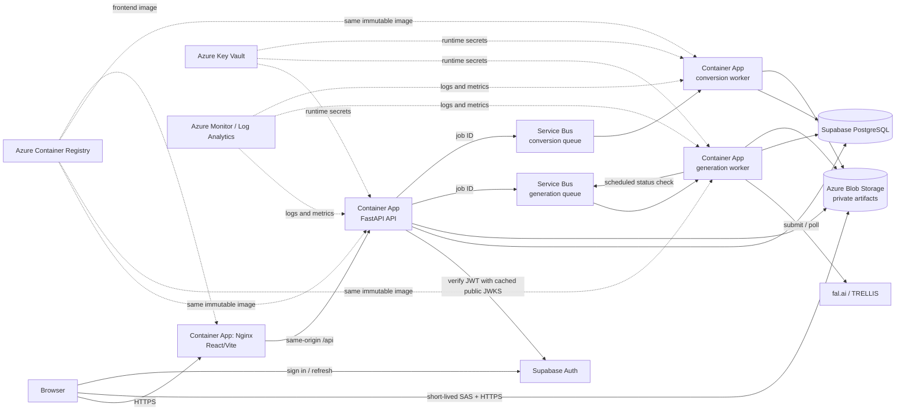

# Azure deployment and CI/CD plan

> Current implementation note (2026-10-30): this document describes the intended Container Apps
> release topology. The successfully tested development deployment instead uses a Linux App Service
> API and two stopped Azure Container Instance workers, with the frontend remaining a Container App.
> Its safe Terraform reconciliation and the distinction between tested deployment and untested
> recreation are recorded in [the Terraform lifecycle runbook](azure-terraform-lifecycle.md).
> This note does not amend an accepted architecture decision; that requires team review.
> For the executable App Service/ACI release process, use [GitHub Actions Azure release setup](github-actions-azure-cicd.md), not the historical Container Apps commands below.

## Status and scope

This document describes the proposed deployment architecture for the capstone. The application is not
deployed *by this repository*. A successfully tested development deployment exists, but its API is a
Linux App Service and its workers are Azure Container Instances, as noted above. The Terraform
refactor under `infra/terraform/` records shared infrastructure separately from that compute topology;
its state handoff/import and recreation have not been executed or tested. It does not provision or
deploy application resources automatically.

Current Azure for Students policy verification found that the subscription permits Japan East, Malaysia
West, Indonesia Central, Central India, and Korea Central, while Static Web Apps' supported
control-plane regions have no overlap. The frontend is therefore a fourth Container App rather than a
Static Web App. ADR-007 records this subscription-specific replacement.

The first deployment has one low-cost development environment only. There is no separate staging or
production environment. The repository uses a small Terraform configuration under
`infra/terraform/`, but no import, state handoff, or application recreation has been performed by
this change. The next reviewed provisioning phase requires immutable backend/frontend images and a
read-only inventory of the live settings before it can be considered. Application releases will later
be automated through GitHub Actions.

The deployment must preserve the existing modular-monolith design. One backend codebase and one
Docker image are deployed as three independently configured Azure Container Apps:

1. FastAPI API
2. Generation worker: source image -> fal.ai/TRELLIS -> GLB
3. Conversion worker: GLB -> LEGO JSON

These are three deployable processes, not three separate codebases. Separating their deployments
allows HTTP traffic, external-provider work, and CPU-intensive conversion work to scale
independently without introducing Kubernetes or additional application layers.

The React/Vite build is a fourth Container App. A small Nginx image serves it with an SPA fallback and
proxies `/api` to the API app by its environment-local Container Apps name.

## Target architecture



The Azure resources should be placed in one resource group and one Container Apps environment. Use
the Azure region closest to the existing Supabase project; Southeast Asia is preferred when the
Supabase project is in Singapore. Keeping data services geographically close reduces latency and
cross-region traffic.

## Proposed Azure resources

| Resource | Proposed tier or mode | Purpose and cost decision |
| --- | --- | --- |
| Azure Container Apps environment | Consumption workload profile | Managed HTTPS, revisions, horizontal scaling, and scale-to-zero without VM or Kubernetes administration. |
| Frontend Container App | 0.25 vCPU, 0.5 GiB; min 0, max 1 | Nginx serves the SPA and proxies `/api`; its HTTPS ingress supplies the public site. |
| API Container App | 0.25 vCPU, 0.5 GiB; min 0, max 2 | Public REST API. Start small and raise limits only after measurements show a need. |
| Generation worker Container App | 0.5 vCPU, 1 GiB; min 0, max 2 | I/O-oriented fal.ai submission and status processing, scaled from generation queue depth. |
| Conversion worker Container App | 1 vCPU, 2 GiB; min 0, max 2 | CPU-intensive deterministic conversion, scaled separately from the API and generation worker. |
| Azure Container Registry | Basic | Private storage for the single backend image; suitable for one low-volume development environment. |
| Azure Service Bus | Basic, two queues | Durable point-to-point generation and conversion jobs. Topics and enterprise messaging features are not required. |
| Azure Storage account | General-purpose v2, Hot, ZRS | Private image, GLB, and LEGO JSON artifacts. ZRS provides zone-level storage resilience where supported. |
| Azure Key Vault | Standard | Stores privileged runtime secrets outside source control and image layers. |
| Azure Monitor and Log Analytics | Consumption-based, bounded retention | Centralized Container Apps logs, platform metrics, dashboards, and alerts. |
| Supabase | Existing Free project | Managed PostgreSQL and Auth; its Free-plan availability and backup limitations are explicitly accepted for the capstone. |

These are starting limits, not performance claims. Load tests and observed memory/CPU usage should
drive any later increase. Maximum replica counts are cost and concurrency controls, particularly for
paid fal.ai work.

## Container Apps configuration

The API and workers pull the same git-SHA-tagged backend image from ACR. The frontend pulls its own
git-SHA-tagged Nginx image. They differ only in startup command, ingress, environment variables,
secrets, resources, and scaling rules.

| App | Container command | Ingress | Scaling signal |
| --- | --- | --- | --- |
| Frontend | Nginx, port 8080 | External HTTPS | HTTP traffic, min 0 and max 1 |
| API | Docker image default: `uvicorn app.main:app --host 0.0.0.0 --port 8000` | External HTTPS | HTTP concurrency, min 0 and max 3 |
| Generation worker | `python -m app.workers.generation_worker` | Disabled | Generation Service Bus queue depth, min 0 and max 2 |
| Conversion worker | `python -m app.workers.conversion_worker` | Disabled | Conversion Service Bus queue depth, min 0 and max 2 |

The frontend requires public ingress. Nginx proxies browser API calls over same-environment service
discovery, so the browser does not need cross-origin access to the API. Container Apps supplies HTTPS,
certificate termination, revision routing, and load distribution; a separate Azure Load Balancer or
Application Gateway is not required for this environment. The workers receive work from Service Bus
and expose no public endpoint.

The API uses `/health` for its startup and liveness checks. Cold starts are accepted because all apps
can scale to zero. For a scheduled demonstration, the team should exercise the end-to-end flow in
advance; temporarily setting the API minimum to one is an operational option only if cold-start delay
is unacceptable and the added cost is approved.

The frontend uses same-origin `/api`, so the API has no browser CORS origins configured. Blob CORS
must allow the exact frontend origin, `GET`, `PUT`, and `OPTIONS`, and only the headers already required by
the direct-upload flow. The artifact container remains private; browser access uses short-lived,
single-blob SAS URLs issued by the authenticated API.

## Queue delivery and worker resilience

Create separate `generation` and `conversion` queues in one Service Bus Basic namespace. Container
Apps KEDA rules scale each worker from its own active-message count and authenticate using managed
identity. Each worker currently receives one message at a time per replica, so queue depth maps
cleanly to bounded parallelism.

Initial queue policy:

- 24-hour default message time-to-live;
- dead-letter expired messages rather than silently dropping them;
- maximum delivery count of 5;
- a `SERVICE_BUS_MAX_LOCK_RENEWAL_SECONDS` value of 900 seconds by default (allowed range
  60--3600 seconds), with actual conversion time validated before launch;
- a database-backed worker-attempt lease lasting 120 seconds by default, renewed every 30
  seconds (both values are bounded configuration); and
- alerts for any dead-lettered message and for a sustained active-message backlog; and
- identifier-only messages; images, GLBs, and LEGO JSON remain in Blob Storage.

Service Bus uses at-least-once delivery, so duplicate messages are expected. Each delivery first
atomically claims a database attempt lease with a unique token. All worker-owned state changes,
including terminal state and authoritative artifact registration, require that unexpired token.
The success-state update and artifact insert share one PostgreSQL transaction. A duplicate that cannot
claim the lease is completed without consuming another delivery; it does not run work or abandon the
valid active attempt. Transient failures are abandoned for bounded redelivery; malformed messages and
exhausted deliveries go to the dead-letter queue for inspection.

If a redelivery finds an active lease, the worker schedules one identifier-only recovery message for
the lease expiry plus a small configured buffer before it completes the redelivery. This keeps a
crashed worker's job recoverable without repeatedly abandoning duplicate messages. Terminal jobs do
not schedule recovery messages. If scheduling fails, the worker leaves the current message unsettled
rather than falsely acknowledging the only recovery signal.
The generation worker schedules a later queue message while fal.ai work is still running rather than
holding a worker or sleeping.

Each received worker message uses the async Azure SDK `AutoLockRenewer` for the configured bounded
duration. The same duration is a local processing deadline: a message that exceeds it is abandoned
only while its lock is valid, and is otherwise left for Service Bus redelivery. If renewal or
completion reports a lost lock, the worker does not attempt another settlement or report success;
the attempt fence makes a later redelivery safe. Conversion and model serialization run in a worker
thread so the async renewal task can continue while CPU work runs. Cancelling `asyncio.to_thread()`
does not kill the underlying thread: the worker keeps one process-local execution gate, so it will not
start another conversion in that process until a cancelled conversion thread exits. The thread's stale
attempt cannot register an artifact or change state after lease loss. This is a soft deadline, not hard
process termination; a pathological native conversion can still delay process shutdown, so input and
conversion bounds must be validated before production rollout. Worker shutdown leaves in-flight
messages unsettled for redelivery.

A generic circuit-breaker library is not proposed. The simpler protections for this workload are
explicit network timeouts, bounded retries, delayed queue checks, maximum job runtimes, maximum
replicas, dead-letter queues, terminal failure states, and alerts. Paid fal.ai submission must never
be retried unless the existing idempotency safeguards prove that it cannot create duplicate paid
work.

## Identity, secrets, and access

GitHub Actions authenticates to Azure using OpenID Connect federation. No long-lived Azure client
secret is stored in GitHub. Deployment permissions are limited to this project's resource group.

Each Container App uses managed identity and receives only the roles it needs:

- frontend: pull only its Nginx image from ACR; it has no Key Vault, Blob, or Service Bus access;
- API, generation worker, and conversion worker: pull the backend image from ACR and read only their required Key Vault secrets;
- API: access the private artifact container and send to both Service Bus queues;
- generation worker: access artifacts, receive from and schedule messages on the generation queue;
- conversion worker: access artifacts and receive from and schedule recovery messages on the conversion queue.

`DATABASE_URL` and `FAL_KEY` are Key Vault-backed secrets. `FAL_KEY` is exposed only to the generation
worker. Azure Storage and Service Bus use managed identity rather than account keys or connection
strings. Browser-safe values such as the Supabase URL and publishable key are supplied to the Nginx
frontend at runtime; privileged Supabase, database, Azure, and fal.ai credentials must never reach
the browser.

Supabase access tokens are sent by the browser to FastAPI as bearer tokens. The existing API verifies
each token locally. Deployment-readiness work will add an in-memory cache for only Supabase's public
JWKS verification keys, with a maximum ten-minute lifetime; it will not cache users' access tokens,
refresh tokens, or sessions. An unknown key ID should force a JWKS refresh, and verification must
fail closed if no trusted matching key is available.

## Supabase Free availability and backup decision

Supabase Free remains the managed PostgreSQL and Auth service for this single development
environment. The project accepts that a Free project may be paused after low activity and that a
temporary Supabase outage makes database-dependent operations unavailable. There is no claimed
database replica, automatic cross-region failover, or production availability guarantee.

Before a demonstration, resume the project if necessary and complete an authenticated end-to-end
smoke test. During a temporary database failure, the API should return a controlled service error,
workers should use bounded retries, and durable queued messages should remain available for later
processing.

External backups are a proposed production-readiness measure, not currently implemented. The
recommended approach is a logical dump before schema migrations and final demonstrations, plus a
weekly dump while the system has active data. Backups would be encrypted and stored outside
Supabase, for example in a separate private Azure Blob container, with at least one restore test.
The procedure must deliberately cover application schema, application data, and Auth users when
account recovery is required; Supabase configuration outside PostgreSQL must be documented
separately.

For the capstone, temporary downtime and manual recovery are accepted. Presentation and repository
documentation must describe external backups as proposed until there is verifiable evidence of a
backup and restore procedure.

## Monitoring and operational limits

Container stdout/stderr logs and platform metrics flow to Log Analytics. Start with a small retention
period appropriate for the capstone and increase it only when there is a demonstrated need. Create a
single email action group and alerts for:

- repeated API 5xx responses or failed health probes;
- repeated container restarts or revisions that fail to become healthy;
- generation or conversion queues with a sustained backlog;
- any dead-lettered message;
- workers repeatedly reaching maximum replica count;
- repeated database, Blob Storage, Service Bus, or fal.ai dependency failures; and
- unusual resource or fal.ai usage that could exceed the project budget.

Application Insights instrumentation is optional for the first deployment. Container Apps metrics,
structured application logs, and Log Analytics are sufficient initially; distributed tracing should
be added only if diagnosis across the API and workers proves difficult.

Set an Azure budget alert for the resource group. Scale-to-zero, the stated replica caps, ACR Basic,
Service Bus Basic and Supabase Free are cost controls. Costs must
still be reviewed because Azure Monitor ingestion, storage, network traffic, and fal.ai usage are not
made free by this architecture.

## Proposed CI/CD release flow

The existing `.github/workflows/ci.yml` already provides the required release gate:

- backend Ruff, mypy, and pytest;
- a backend Docker image build;
- frontend ESLint, Vitest, and production build; and
- Terraform formatting and offline-backend validation on Terraform-related pull requests; and
- locked dependency installation with `uv` and `npm ci`.

Deployment automation should extend this foundation rather than duplicate it. A push to `main`
deploys the one development environment only after all required CI jobs succeed:

```text
push reviewed commit to main
  -> required backend, image, and frontend CI succeeds
  -> GitHub OIDC login to Azure
  -> build backend and frontend images and tag each with the full git SHA
  -> push both immutable images to ACR
  -> apply reviewed, forward-compatible PostgreSQL migrations once
  -> deploy API revision using that SHA
  -> deploy generation-worker revision using that SHA
  -> deploy conversion-worker revision using that SHA
  -> deploy the Nginx frontend Container App revision using its SHA
  -> run read-only API health and frontend availability smoke tests
  -> report the deployed commit and URLs in the workflow summary
```

The same immutable image SHA must be used by all three backend apps so a release is reproducible.
Mutable tags may exist for convenience but must not be the deployment source of truth. Environment
settings and secrets are deployment configuration, not image build arguments.

Container Apps revisions provide application rollback. If a new backend or frontend revision is
unhealthy, redeploy its last verified image SHA.
Database migrations are forward-only and are not automatically rolled back with application code;
reviewed migrations should therefore be backward-compatible with the previously deployed revision
where practical.

## Deployment acceptance checks

The first deployment is complete only when the following evidence exists:

- the frontend loads over HTTPS from its Nginx Container App and deep links return the SPA;
- sign-up or sign-in through Supabase works with the deployed redirect URL;
- an authenticated browser request reaches the public API;
- direct private-Blob upload works from the exact frontend origin;
- generation messages start generation-worker replicas from zero;
- conversion messages start conversion-worker replicas from zero;
- an image completes the image -> GLB -> LEGO JSON backend pipeline;
- unauthorized access and cross-user artifact access remain rejected;
- logs for all four Container Apps are visible centrally;
- a failed test message can be found in the correct dead-letter queue;
- the deployed backend apps report the same immutable image SHA; and
- the GitHub Actions deployment can redeploy the previous known-good application version.

The LEGO frontend viewer is a separate product-completion item. Its absence does not change the
three-process backend deployment topology, but it must not be presented as implemented until the
browser can request and render the conversion result.

## Explicitly deferred

The following are outside the first deployment and should not be added without a demonstrated need:

- separate staging and production environments;
- AKS/Kubernetes or Azure virtual machines;
- a separate load balancer or API gateway;
- multi-region active-active deployment;
- paid Supabase high availability, read replicas, or point-in-time recovery;
- automated external database backup jobs;
- Redis or another shared cache;
- a generic circuit-breaker framework; and
- Application Insights distributed tracing.

## Reference documentation

- [Azure Container Apps scaling](https://learn.microsoft.com/azure/container-apps/scale-app)
- [Azure Container Apps plan types](https://learn.microsoft.com/azure/container-apps/plans)
- [Azure Service Bus dead-letter queues](https://learn.microsoft.com/azure/service-bus-messaging/service-bus-dead-letter-queues)
- [Azure Container Registry tiers](https://learn.microsoft.com/azure/container-registry/container-registry-skus)
- [Supabase database backups](https://supabase.com/docs/guides/platform/backups)
- [Supabase Free project pausing](https://supabase.com/docs/guides/platform/free-project-pausing)
- [Supabase JWT signing keys and JWKS caching](https://supabase.com/docs/guides/auth/signing-keys)
